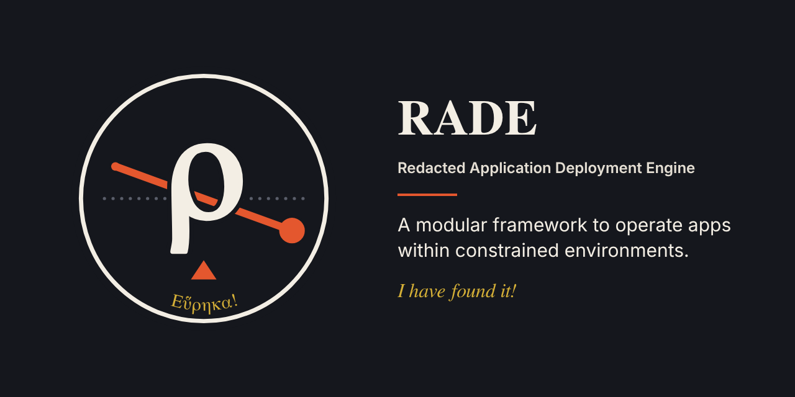

# RADE

<b>Redacted Application Deployment Engine</b>

<!-- site:intro -->
Deploy and test applications on a locked-down work computer from one pasted PowerShell window: checks, files, steps and a results e-mail. RADE checks the computer first, saves the application's files, guides you through each step, and keeps a record of the install. After the install, the application works without RADE.
<!-- /site:intro -->

---

### 🔺 Summary

<!-- site:key-facts -->
<table>
<tr><td><b>Checks first:</b></td><td>checks the computer and your site rights before any step; a failed check stops the install.</td></tr> <!-- source: docs/engine.md "Check stages" and "Results" -->
<tr><td><b>NIPR only:</b></td><td>runs only where the computer's full name holds the NIPR domain; elsewhere it stops before it writes a file.</td></tr> <!-- source: docs/engine.md "Guardrails", NIPR only -->
<tr><td><b>Credentials:</b></td><td>CAC sign-on in a browser window for each run; nothing is stored.</td></tr> <!-- source: engine/ps/16-site-scripts.ps1, Connect-PnPOnline -UseWebLogin -->
<tr><td><b>Access:</b></td><td>only sees what your account can see; only accepts a DAF SharePoint address.</td></tr> <!-- source: docs/engine.md "Guardrails", Site address -->
<tr><td><b>Boundary:</b></td><td>nothing leaves DoD365, except the test-round results e-mail (masked counts, sent by hand) until the test rounds end.</td></tr> <!-- source: AGENTS.md "DoD365 boundary" -->
<tr><td><b>Verifiable:</b></td><td>read the commented code as plain text before you paste it; the window warns when the script does not match its hash.</td></tr> <!-- source: engine/ps/window/05-alignment.ps1 (ScriptWarn); each application README "Open the script" link (a .txt file) -->
<tr><td><b>Accessible:</b></td><td>paste and run via ISE; no code download, no admin rights, no policy change.</td></tr> <!-- source: AGENTS.md "No code fetch at run time"; 90-161.Z ISSM ruling 2026-11-13 -->
<tr><td><b>Maintenance:</b></td><td>Diagnose, Back up and Restore from the application's card.</td></tr> <!-- source: docs/engine.md "Maintenance run types" -->
<tr><td><b>Independent:</b></td><td>delete RADE and the application still works.</td></tr> <!-- source: docs/engine.md "RADE and the app", After the install -->
</table>

> Need help? Ask in the Teams channel **RHOPE-OPS**.
<!-- /site:key-facts -->

---

### 🔺 The script

RADE has no script of its own. You copy the script from the README of an application, for example its **Open the script** link. That script is the RADE wrapper with the application inside it. RADE checks the computer and installs the application. Then the application runs without RADE.

---

### 🔺 How it works

<kbd>Paste in ISE</kbd> → <kbd>Check the computer</kbd> → <kbd>Choose an application</kbd> → <kbd>Check what it needs</kbd> → <kbd>Install, step by step</kbd> → <kbd><b>Start</b></kbd>

#### Check results

| Result | Means |
|---|---|
| PASSED | The check passed. |
| PASSED (fallback) | Passed with the documented route for wings with less access. |
| WARNING | You can go on; read the note. |
| FAILED | The install cannot start. The window says what to fix. |
| NOT RUN | The check could not run. This also stops the install. |

#### Maintenance

| Button | Does | Asks first |
|---|---|---|
| Install / Update / Repair | Adds what is missing, keeps your data | No |
| Diagnose | Read-only checks; each finding names its fix | No |
| Back up | Saves each of the application's lists to your computer | No |
| Restore | Puts missing rows back, from the Recycle Bin or a backup | Yes: a dry run with counts, then you type the application name |
| Uninstall | Backs up, then runs the application's own Uninstall steps; test sites only. Your local files and backups stay | Yes: you type the application name |

---

### 🔺 Limitations

| RADE cannot | What to do |
|---|---|
| See an install on another site | A search across sites is network reconnaissance, so RADE never does it. Ask the site owner. |
| Update an application that another account installed | Install with the same account, or ask a site owner to clear the install record. |
| Do a step that the platform does not let a script do (for example a Power Automate import) | RADE shows numbered steps; do them, then select Done or It failed. |
| Restore on a site that is not a test site | Restore runs only on the application's test sites. |
| Restore a person who is not on the site | That field stays empty; fill it in by hand. |
| Uninstall on a site that is not a test site | Uninstall runs only on the application's test sites. |
| Remove RADE while an application is installed | Uninstall each application first; then select Remove RADE on the Choose screen. |

---

### 🔺 Safety

- **No reconnaissance:** never looks for hosts, pings, checks ports or probes network boundaries.
- **One host:** signs in only to an address with the DAF SharePoint prefix.
- **No code fetch at run time:** the paste is the whole program; data files are checked by SHA-256.
- **No stored credentials:** you sign in with your CAC each run; no password or token is saved.
- **No scripts in results:** the results never contain a script or program file.
- **Asks before a write that cannot be undone:** a dry run with counts, then you type the application name.
- **One install per site:** an install record on the site stops a second install by mistake.

---

### 🔺 Build an application with RADE

To deploy your own application with RADE, start with [docs/make-an-app.md](docs/make-an-app.md). To report a vulnerability, see [SECURITY.md](SECURITY.md).
